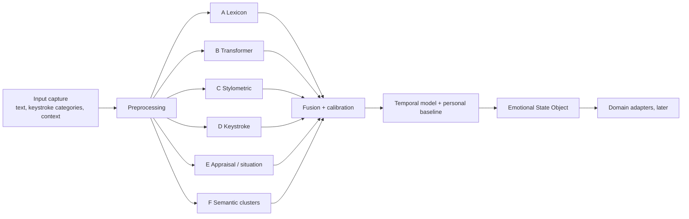

# Architecture

> Status: skeleton. The full design (diagrams, schemas, interfaces) is the Phase 2 deliverable.

## Pipeline (from the brief, §4.1)

## Code layout

| Path | Responsibility |
|---|---|
| `engine/schemas.py` | Pydantic `EngineOutput`, `EmotionalStateObject` (Phase 2) |
| `engine/preprocessing/` | language ID, tokenising, negation scope, intensifiers, emoji, style cues |
| `engine/engines/` | one module per signal engine, all behind the same `analyze()` interface |
| `engine/fusion/` | weighted late fusion, stacking, calibration |
| `engine/temporal/` | personal baseline, EMA / Kalman / HMM smoothing |
| `engine/mappings/` | label maps (GoEmotions to Plutchik/Ekman), scale conversions |
| `engine/adapters/` | domain adapter interface + `travel_v0` |
| `engine/privacy.py` | privacy defaults (telemetry off) |
| `api/` | FastAPI service (Phase 4) |
| `ui/` | personal-study chat app (Phase 5) |
| `eval/` | evaluation suite and reports |

## Ethics, safety, legal (to be expanded in Phase 2)
- The Engine estimates; it does not diagnose.
- `safety_flag` for self-harm or danger is a hard rule in the core, not left to adapters.
- EU AI Act limits emotion recognition in workplaces and education; keystroke and emotion data
  are sensitive personal data. The tutoring use case needs specific legal review.
- Privacy: raw text and keystroke data stay local or in your own Supabase project; third-party
  telemetry is off by default (ADR-0007).
