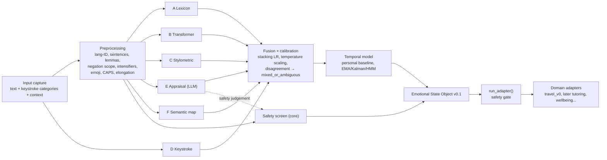
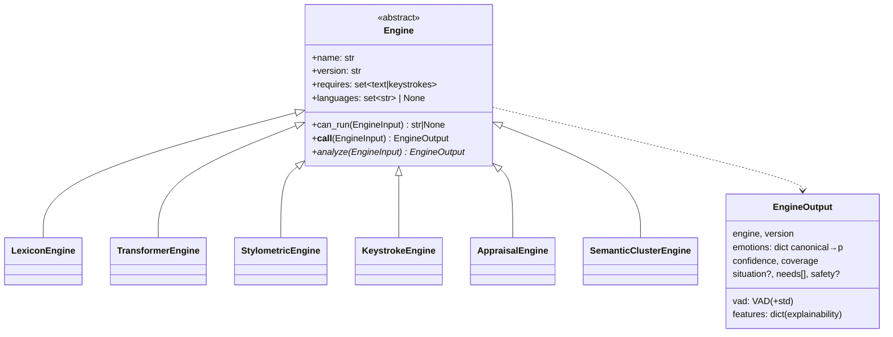

# Architecture

Status: **Phase 2 design**. Schemas, interfaces, mappings, safety rule and the toy adapter are implemented and tested. Engines, fusion and the temporal model are typed stubs filled in during Phases 3–4.

## 1. Pipeline

Every arrow carries a typed Pydantic object (`engine/schemas.py`); JSON Schemas are exported to `docs/schema/`.

## 2. Engine contract

- `__call__` runs `can_run` first. Missing modality, empty text or unsupported language returns `EngineOutput.empty(...)` with `confidence = coverage = 0`, so fusion simply drops that engine. **Missing modalities never raise.**
- New modality (voice, camera) = new `Engine` subclass with `requires={"audio"}` etc. Fusion's input is still a list of `EngineOutput`, so nothing else changes.
- `languages=None` means language-agnostic (keystrokes, LLM appraisal, multilingual embeddings). English-only engines skip non-English messages, which implements the brief's rule that mixed/Armenian/Russian text goes to the multilingual path.

## 3. Canonical representation

| Thing | Canonical form | Where |
|---|---|---|
| Discrete emotions | GoEmotions 27 + neutral (28) | `mappings/labels.py::CANONICAL` |
| Coarse views | Ekman 6, Plutchik 8, via **weighted** tables; each row sums to 1; projection uses max-of-weighted (multi-label safe) | `TO_EKMAN`, `TO_PLUTCHIK` |
| Other datasets | DailyDialog ids, SemEval E-c, EmoSurv → canonical | `*_TO_CANONICAL` |
| VAD | [-1, 1] for every dimension | `mappings/scales.py` (Warriner 1–9, SAM 1–9, EmoBank 1–5, NRC v1 0–1, NRC v2 already ±1) |
| Situation | `EventType` (16), `Agent` (4), appraisals in [-1,1] or [0,1] | `labels.py`, `schemas.Situation` |
| Need | `NeedType` (7): emotional_support, practical_solution, information, change_of_scene, rest, celebration, connection | `labels.py` |

## 4. Fusion and calibration (Phase 4)

1. **Baseline:** weighted late fusion, w_engine = prior × confidence × coverage.
2. **Stacking:** a fixed-width feature vector per message (each engine's probabilities, VAD, confidence, coverage, plus a *present* flag so missing engines are learnable) → logistic regression (one-vs-rest per label) for emotions, ridge for VAD. Trained on a held-out split that **no engine saw during its own training**.
3. **Calibration:** temperature scaling on the stacker's logits; report ECE (15 bins) and reliability diagrams. Target ECE < 0.1.
4. **Uncertainty:** `overall_confidence = f(mean engine confidence, inter-engine disagreement (Jensen-Shannon on emotions, std on VAD), coverage)`. If disagreement exceeds a threshold tuned on validation data, set `mixed_or_ambiguous = true` instead of averaging. If the top calibrated p is below a threshold, set `uncertain = true` and keep `neutral`/no label rather than inventing one.

## 5. Temporal model (Phase 4)

- **Baseline:** per user, Welford running mean/variance of VAD, stylometric and keystroke features → z-scores. Cold start uses population priors and widens `std`.
- **Smoother:** EMA first, then Kalman on VAD (measurement noise = fused `std`), HMM over discrete moods only if it wins on synthetic trajectory tests.
- **Pattern:** baseline deviation (valence z), trend (slope sign over a window, with a significance gate), volatility (std of first differences), recurring triggers (event types followed by negative valence shifts).

## 6. Emotional State Object

See `docs/schema/emotional_state_object.v0.1.json`. Additions beyond the brief's example: `uncertain` (honesty rule), `safety_flag`, `situation.event_type_p`, `situation.certainty`, `situation.norm_violation`, `pattern.n_messages`, `pattern.recurring_triggers`.

## 7. Domain adapters

`Adapter.adapt(ESO, user_profile) -> DomainSuggestion`. Products must call `run_adapter()`, which **short-circuits on `safety_flag = urgent`** and returns help resources instead of domain content. `travel_v0` is a rule-based demo: low valence + low arousal + need=rest → calm nature first.

## 8. Privacy

- Keystrokes are stored as `KeyCategory` + timestamps only; the schema has **no field that can hold a character**.
- Raw text and features stay local (SQLite) or in your own Supabase project (Phase 5). `DELETE /user/{id}/data` removes text, features, baseline and pattern state.
- The only third-party call is engine E → Anthropic API, optional, and can be switched off (the local fallback then runs).

## 9. Multilingual

All language-specific resources sit behind a `language` key (engine `languages` attribute + resource packs). English: all engines. Russian/Armenian/mixed-script: language-agnostic engines only (D, E, F with multilingual MiniLM) until dedicated resources are added; confidence drops automatically through lower coverage. NRC lexicons ship auto-translated ru/hy columns. Usable as a weak prior, flagged low quality.

## 10. Ethics, safety, legal

- **Estimates, not diagnoses.** No clinical claims in any output or product copy.
- **Crisis safety is a core rule** (`engine/safety.py` + `run_adapter`). Phase 2 uses a conservative phrase screen (prefers false positives); Phase 3 adds the LLM's judgement; `safety.merge` always keeps the most severe level.
- **EU AI Act:** Article 5(1)(f) prohibits emotion-recognition systems in the **workplace and education** (except medical/safety reasons), and emotion recognition elsewhere is a transparency-obligation / high-risk area. **Your tutoring use case falls in the education prohibition if deployed in the EU (and potentially for EU students). Get legal advice before building it on this engine.**
- **GDPR-style laws:** emotion and keystroke data inferring mental state is sensitive personal data. Every product needs explicit consent, a clear purpose, data minimisation, and a delete path.
- **Bias:** Phase 3/4 reports per-group performance (writing style, dialect proxies, non-native English).
