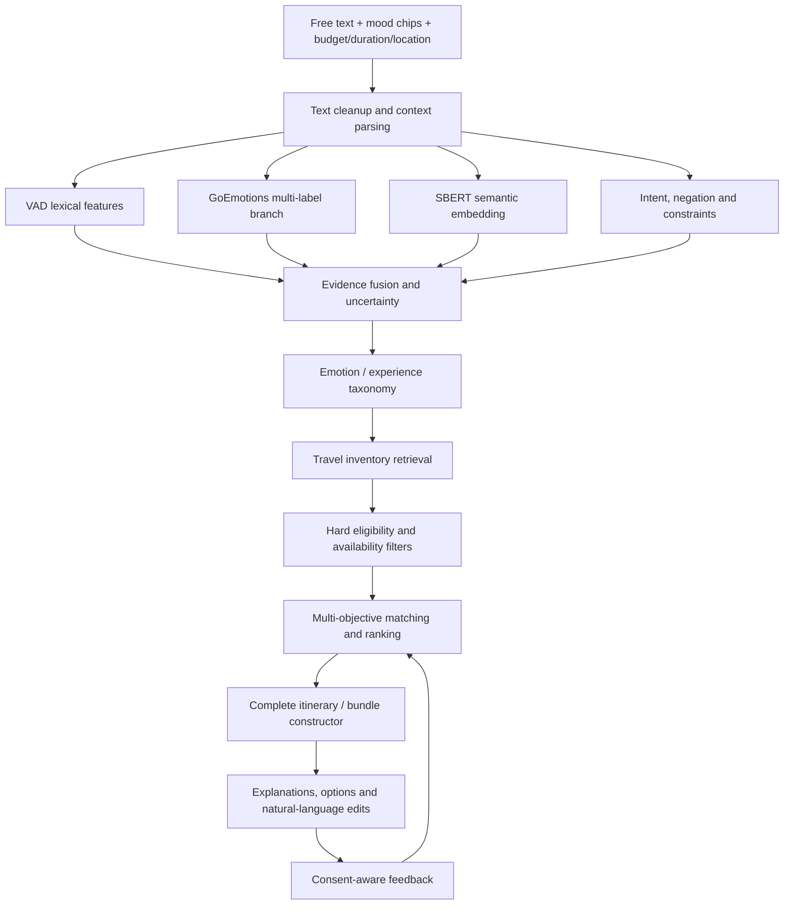

# WIYMOOD / TRAVEL AI
## Complete consolidated historical handoff and research reconstruction

**Prepared:** 19 November 2026  
**Purpose:** One self-contained document to give to another AI, researcher, developer, or future team member.  
**Period represented:** 2025 project conversations, plus the later October–November 2026 independent emotional-understanding direction.  
**Language:** English.  
**Nature of this document:** A reconstruction of recoverable conversation history and two previously prepared handoff documents, **not a verbatim export of every past chat and not a copy of the original source-code repository**.

> **NON-NEGOTIABLE EVIDENCE RULE.** Distinguish discussion, proposal, generated skeleton, demonstrated mockup, measured result, and deployed implementation. The full original chat transcripts, original repository, real datasets, trained model weights, fitted UMAP/HDBSCAN objects, original ZIP, and original repository README are **not available in the recovered material**. Do not attribute invented accuracy numbers, trained checkpoints, real reservations, provider integrations, or production readiness to this project.

---

# PART A — EXECUTIVE PROJECT MEMORY

## 1. What this project was

The product was called **Wiymood**, also referred to as **Travel AI**. Its original hypothesis was that ordinary travel search considers price, dates, hotel star ratings and destination but often fails to capture **how someone is feeling, what emotional state they wish to reach, and what kind of experience would suit them**.

The central product promise was roughly **“turn your mood into a trip.”** Instead of requiring the traveler to know a destination, the system could start with an open-ended statement such as:

> “I'm exhausted from work and want a quiet four-day escape, but I don't want to be alone all the time.”

The NLP system would attempt to distinguish:

- Present state: fatigue/exhaustion, possibly stress.
- Desired state: calm, restoration.
- Social preference: some connection, **not** total isolation.
- Constraints: four days; remaining parameters (dates, budget, origin) need clarification or collection.
- Candidate travel themes: quiet nature, wellness, gentle cultural activities, small-group experiences; **these are possible candidate themes, not psychological facts or guaranteed recommendations**.

It would then retrieve relevant destinations and products, and assemble a bundle with transport/flights, lodging, restaurants, experiences, local transfers, routing and a total estimated cost. A user could correct the itinerary in natural language, with subsequent ranking adapting to explicitly stated preferences and consented feedback.

**Two related but distinct scopes emerged:**

1. **Original scope (2025):** a mood-aware travel and local-experiences platform with bundled booking, smart guide, navigation and community.
2. **Later scope (24 October 2026 onward):** a more general-purpose **Human Emotional Understanding Engine** (HEUE is a descriptive label, *not confirmed product branding*) that can interpret complex emotional language across domains, with travel as one optional application.

The later concept must not erase the original travel product, and the original travel product must not constrain research into the standalone emotional engine.

## 2. Recoverable chronology and discussions

The following entries are supported by recoverable earlier-chat summaries/context. The date identifies the discussion, **not necessarily an implementation milestone**.

| Date | Recoverable discussion or artifact | Evidence quality |
|---|---|---|
| 2 Sep 2025 | Elevator pitch: emotion/intent in free text leads to complete travel bundles including flights, hotels, food, activities and eventual payment. | Earlier discussion |
| 8 Sep 2025 | Pitch, initial MVP/traction language, two-to-three proposed bundles; unverified prototype claims must not become facts. | Pitch discussion |
| 10 Sep 2025 | Mood engine, weather and taste matching, health/calorie-related ideas, smart guide, navigation, budget/revenue-aware combos. | Feature brainstorming |
| 11 Sep 2025 | GPT/FastAPI orchestrator starter described as a generated ZIP, with specialized agents and mood-aware ranking. | Prior assistant-generated starter described; original bytes not recovered |
| 13 Sep 2025 | Mood engine pipeline: brief user input, affect and intent, personal baseline, contextual filtering, candidate scoring and routed micro-plan; site/app UX concepts. | Detailed conceptual design |
| 17 Sep 2025 | Investor framing and marketing claims; several large quantitative market claims were specifically flagged as unverified. | Pitch, not evidence of traction |
| 22 Sep 2025 | SBERT, GoEmotions, Warriner VAD, UMAP/HDBSCAN/K-means; emotional themes and emotion-to-travel mapping; multi-objective trip ranking. | Detailed algorithmic blueprint |
| 23 Sep 2025 | Bundling, duration/budget, weather, transport, local guide, adaptive experience and future functionality. | Product planning |
| 24 Sep 2025 | Emotional text analysis, clusters/soft membership, conceptual experience “boxes,” weighted fusion and heuristic fallbacks, complete bundle ranking. | Detailed design, closest match to remembered clustering discussion |
| 25 Sep 2025 | Natural-language trip generation and emotion interpretation, full travel packages. | Product/architecture discussion |
| 27 Sep 2025 | Minimal static demo: text, budget/duration, simple theme mapping and prewritten JSON offer cards; explicitly **not** a real connected travel API. | Demo specification |
| 18 Oct 2025 | Mood chips + free text, explicit free-text intent taking precedence over conflicting mood chips, then budget/duration and 3–4 generated trip cards. | UX specification |
| 24 Oct 2026 | Decoupling research from travel: domain-independent emotional/intention language understanding with negation, sarcasm, temporal context, uncertainty, privacy. | Later proposed research direction |
| 19 Nov 2026 | A reconstructed `README.md` and a ready-to-send `HANDOFF_PROMPT.md` are available in ChatGPT Library; this file consolidates their content and the recoverable historical details. | Reconstructed documents, not original repo export |

**Most relevant conversations to locate manually:** 22–24 September 2025, particularly **24 September 2025** for the “big boxes” of emotions/travel components; 11–13 September 2025 for code architecture; 18 October 2025 for the user flow.

## 3. What we can safely call findings

1. **Sentiment alone is insufficient:** “positive/negative/neutral” fails to distinguish exhaustion, frustration, grief, excitement, curiosity, need for stimulation, and desire for recovery.
2. **Current feeling and desired experience are different variables.** Someone who feels anxious may want relaxation rather than “anxiety-themed” experiences. This is a design finding, not a validated clinical finding.
3. **Three complementary representations were selected for exploration:** lexical dimensional affect (VAD), fine-grained multi-label emotion recognition (GoEmotions), and sentence-level semantic embedding (SBERT), with intent/constraints treated separately.
4. **Clustering is useful for discovering reusable experience themes, but it cannot interpret language by itself.** UMAP/HDBSCAN/K-means were considered for catalog/taxonomy structure, not as a magic psychological classifier.
5. **A trip requires ranking under constraints, not merely matching a mood.** Budget, time, departure location, availability, weather, diversity, travel time and explicit preferences must all be considered.
6. **Feedback should update ranking, not be mistaken for unrestricted psychological profiling.** Edits, saves and explicit likes can be signals; consent and transparent controls matter.
7. **The broader human-emotion problem was recognized as distinct from travel recommendation.** It warrants its own dataset, evaluation, model interface and error taxonomy.

**Not recovered:** quantitative experimental results, trained-model accuracy, verified cluster counts, final user segment counts, results tables, statistical significance, reproducible notebooks or tested results on real travelers. Any numbers introduced below as examples are illustrative, not historical experimental outputs.

---

# PART B — THE ORIGINAL EMOTIONAL NLP RESEARCH

## 4. Representations: VAD, GoEmotions, semantic vectors, and intent

### 4.1 VAD: Valence, Arousal, Dominance

The three-dimensional emotional signal was described as:

`affect = [valence, arousal, dominance]`

- **Valence (V):** unpleasant ↔ pleasant emotion.
- **Arousal (A):** low energy ↔ high activation.
- **Dominance (D):** low perceived control ↔ high perceived control.

A phrase such as “overwhelmed” may have low pleasantness, high activation and low perceived control. “Peaceful” can carry positive valence with low activation. Both may trigger different desired travel experiences. **These are qualitative illustrations, not predictions produced by the recovered model.**

We discussed two distinct kinds of VAD resources:

- **Warriner, Kuperman and Brysbaert (2013):** ratings of approximately **13,915 English lemmas** on VAD dimensions; word-level data.
- **NRC VAD Lexicon:** another source of word-level affect ratings, potentially an alternative or supplementary lexicon.

A naive mean of word scores loses scope, negation and compositional meaning. “I do **not** want excitement” must not simply map to high arousal because “excitement” is present. Therefore VAD lexical lookup was planned as a *feature*, not a complete sentence comprehension model.

### 4.2 GoEmotions

Google Research **GoEmotions** contains approximately **58,000** English Reddit comments annotated for **27 emotion categories plus neutral**. It is relevant for a *multi-label* emotional classification branch: statements may communicate more than one emotion.

The proposed branch would produce something like:

`emotion_probs = {joy: p1, sadness: p2, fear: p3, ..., neutral: p28}`

These are probabilities or scores *only if* a specific trained model provides them. **The dataset name is not itself an inference model, and a selected transformer checkpoint is not documented as successfully deployed in the recovered material.** Domain shift from Reddit comments to travel intentions is a major risk.

### 4.3 Sentence embeddings / SBERT

A specific historical candidate was:

`sentence-transformers/all-MiniLM-L6-v2`

This model produces **384-dimensional** sentence embeddings. Its role was to capture semantic similarity/context beyond keywords and VAD dictionaries. The word “bank” in “river bank,” for example, must not be treated as a purely lexical emotional signal. More relevant to this project: “I want somewhere quiet to reset” and “I need a peaceful break to recharge” should be semantically related even with different exact words.

Semantic similarity can support theme retrieval, catalog organization and cold-start text-to-experience matching. It does not automatically identify emotional cause, target, intent, sarcasm or future preference.

### 4.4 Intent, polarity, scope and explicit constraints

The design called for separate modeling of **emotion** and **requested action**:

- Current felt emotion.
- Desired emotional state.
- Stated travel goal (rest, discovery, connection, celebration, adventure, exploration, escape).
- Explicit likes and dislikes.
- Negation/contrast (“not”, “but”, “rather than”).
- Companion/social context.
- Location, dates/duration, budget and accessibility constraints.
- Confidence/ambiguity and sources of evidence.

Do not convert all these signals into one hard-coded “personality type.” A person's preference can be temporary and context-specific.

## 5. Historical offline taxonomy and clustering workflow

This is the most concrete recovered outline of the clusterization work. It is a **design blueprint**; fitted artifacts were not recovered.

```text
Collect a suitable text/intent corpus
    |
    v
Cleaning, tokenization, linguistic normalization
    |
    v
spaCy lemmatization + synonym/phrase normalization
    |
    +-------------------+--------------------+
    |                   |                    |
    v                   v                    v
Lexical Warriner/   Sentence embeddings    Optional GoEmotions
NRC VAD features    via MiniLM / SBERT     multi-label features
    |                   |                    |
    +-------------------+--------------------+
                        |
                        v
          Consistent feature scaling and fusion
                        |
                        v
            UMAP low-dimensional projection
         (cosine metric; ~2–10D discussed)
                        |
                        v
          HDBSCAN density-based group discovery
              + optional subclustering
                        |
                        v
          TF-IDF/keyphrases, representative phrases
                        |
                        v
             Inspect coherence and stability
                        |
                        v
             Human-readable theme taxonomy
                        |
                        v
       Save fitted models, transforms, taxonomy versions
                        |
                        v
            Map travel inventory to themes
```

### 5.1 Preprocessing

Historically mentioned:

- `spaCy`, specifically the language package `en_core_web_md` in an earlier blueprint.
- Lemmatization and cleaning.
- Synonym and phrase normalization.
- Feature extraction from words and contextual sentences.
- Appropriate handling of stopwords, negation and linguistic context rather than blind deletion.

Normalization should be reproducible and multilingual processing must be separately verified if the project expands beyond English.

### 5.2 Feature fusion

Discussed conceptually: combine VAD, emotion-label and embedding evidence with intent features, then scale and weight features appropriately. **Exact historical weights were not recovered.**

An *illustrative* representation (not recovered code or exact historical method) is:

```python
features = concatenate([
    scaled_vad,                  # e.g., three affect dimensions
    scaled_emotion_probabilities,# multi-label emotion output
    normalized_sentence_vector, # e.g., 384D embedding
    structured_intent_features, # current vs desired state, likes/dislikes
])
```

A critical mathematical issue: a 384D embedding concatenated with only 3 VAD values can dominate a distance metric unless features are standardized/weighted, and combining heterogeneous spaces is not always best accomplished by raw concatenation. Compare early fusion with **late fusion** (separate scores merged after inference) experimentally.

### 5.3 UMAP

**UMAP** was discussed to reduce dense semantic/affect representations into a lower-dimensional space, with cosine distance and approximately **2–10 dimensions** appearing in the historical blueprint. The exact hyperparameters and fitted projection are unavailable.

Important: two dimensions are helpful for visualization but may be worse for downstream clustering. Validate stability rather than treating visual separation as proof of natural psychological categories.

### 5.4 HDBSCAN; K-means as a possible fallback

**HDBSCAN** was proposed for discovering variable-density clusters with a possible noise/outlier group; “soft” or probabilistic cluster membership was discussed as a way to avoid forcing every utterance into one rigid category. **K-means** was a possible simpler fallback/baseline, not a confirmed trained production component.

These groups were intended to capture reusable thematic/experience structures, possibly with broad clusters and subclusters. No genuine number of groups, minimum-cluster-size, performance, or stable cluster IDs was recovered.

For a new user utterance, **reuse the trained/fitted transform and saved cluster/reference representations**. Never re-fit UMAP/HDBSCAN on every request; out-of-sample assignment must be implemented using supported prediction/projection methods or a separate nearest-prototype model, and validated explicitly.

### 5.5 Labeling clusters / building the “big boxes”

The remembered “big boxes” correspond most plausibly to the earlier **emotion/experience theme groups** and the catalog of travel components within those groups. Earlier discussions referenced broad labels such as:

- Relaxation / Calm / Recovery
- Romance / Connection
- Adventure / High-energy exploration
- Culture / Discovery
- Nature / Escape
- Food / Taste
- City life / Social activity

**This is a collection of examples from discussions, not an exhaustively recovered final trained taxonomy.** A user should often be matched to multiple boxes with relative scores, not assigned a permanent “type of person.”

Representative keyphrases and TF-IDF-style terms were proposed to explain clusters and support human labeling. Taxonomy quality needs manual assessment, and clusters can be unstable across data/model versions.

### 5.6 Travel-inventory “boxes”

The travel products were also discussed as components to group and rank by suitable experience characteristics:

| Inventory group | Candidate matching properties |
|---|---|
| Destinations | pace, accessibility, climate/weather, culture, overall setting, season |
| Flights / transport | origin, dates, duration, cost, reliability, schedule |
| Hotels / lodging | quietness, location, social setting, comfort, cost, amenities |
| Restaurants | cuisine, atmosphere, dietary preferences, location, price |
| Activities / experiences | energy level, novelty, relaxation, social intensity, theme, opening times |
| Transfers / local navigation | travel time, routes, mobility constraints, safety, price |
| Guides / events | interests, pace, language, schedule, group size |

These are candidate feature definitions and **do not imply that any provider returned these attributes**. Many “vibe” attributes require curation or evidence-based enrichment; do not fabricate them.

## 6. User profile matching and recommendation logic

We discussed constructing a **contextual traveler profile** from the message and explicit settings, matching that profile to one or several themes and retrieving candidate products. In a conservative schema:

```json
{
  "current_state": {"emotions": [], "vad": null},
  "desired_state": {"goals": [], "vad": null},
  "explicit_preferences": {"likes": [], "dislikes": []},
  "trip_constraints": {
    "origin": null,
    "dates": null,
    "duration_days": null,
    "budget": null,
    "party_size": null
  },
  "theme_scores": {},
  "uncertainty": [],
  "evidence_spans": [],
  "consent_scope": "session_only"
}
```

This is an *illustrative integration contract* added for transferability, **not original recovered repository code**.

### 6.1 High-level matching procedure

1. Parse the user's utterance and practical trip constraints.
2. Estimate emotional indicators and multi-label intent without assuming the emotions are facts.
3. Resolve clear negation and preference conflicts; ask for critical missing constraints if necessary.
4. Produce scores for relevant themes; permit multiple matches and uncertainty.
5. Retrieve travel inventory available for dates, party, origin, budget and location.
6. Apply hard exclusions first (availability, infeasible transport, prohibited budget overflow, explicit dislikes, etc.).
7. Rank feasible products and bundles by mood/intent fit **and** practical relevance.
8. Diversify candidate itineraries so they represent meaningful alternatives.
9. Show clear trade-offs/explanations and allow natural-language edits.
10. Save feedback only under the intended privacy/consent policy.

### 6.2 Multi-objective scoring

An earlier conceptual score combined emotional fit with explicit taste and practical fit:

```text
candidate_score = weighted_combination(
    emotion_or_goal_fit,
    preference_fit,
    budget_fit,
    travel_time_fit,
    weather_fit,
    availability_or_schedule_fit,
    diversity_or_novelty_fit
)
```

The project also explored commercial feasibility/revenue-aware bundles, but supplier economics should never silently override the user's explicit constraints or be mislabeled as a personalized recommendation.

**No historical numeric weights, calibrated probabilities, ranking metrics or measured gains were recovered.** A robust implementation must document weights separately and tune/test them with offline labels, user testing and real booking/outcome signals if legally and ethically available.

### 6.3 Feedback and personalization

Possible signals discussed: itinerary edits, clicked cards, saves, accepted/removed activities, selected themes, bookings, and satisfaction ratings. Explicit correction (“less crowded”, “more adventurous”, “cheaper”) should override inferred preferences in the current session.

Separate:

- Session state: the person’s needs right now.
- Persistent preferences: only saved with an appropriate lawful basis/consent and user controls.
- Observed implicit signals: noisy and not proof of emotional identity.

A preference model should not expose or assert permanent personality labels or clinical diagnoses.

## 7. ONNX and the user's recollection of other Python methods

The user remembers **ONNX libraries / ONNX models**. The recovered historic technical blueprint confirms Sentence Transformers, transformer-style classification, VAD datasets, spaCy, UMAP, HDBSCAN, K-means and related tools, **but it does not verify a particular ONNX model, runtime, export script, quantization method or benchmark**.

ONNX may have been investigated for optimized inference; this remains **unverified** until the old environment, source files or chats are found. Do not write that `onnxruntime` was definitely installed or used. If source code reveals it, document the exact model path, opset, providers, preprocessing/tokenization compatibility and output parity.

The user's recollection of a Python “capitalization method” is also **ambiguous**. Possibilities in this subject area include lemmatization, normalization, categorical encoding, vectorization, dimensionality reduction or clustering, but **none should be retroactively asserted as the method the team used**. The recoverable named methods are listed explicitly above.

---

# PART C — SYSTEM ARCHITECTURE AND PRODUCTS

## 8. End-to-end conceptual travel architecture



**Offline**: prepare corpora, build features, discover clusters, inspect labels, map catalog themes, fit/store models.  
**Online**: parse user text, infer emotional and practical goals, score against frozen/versioned artifacts, retrieve current inventory, rank and assemble a feasible trip.

### 8.1 User experience and screens

The earlier app/site concept included bottom navigation with:

- **Smart Guide**
- **Trip Generator**
- **Navigation**
- **Wiymood Club**

The **Trip Generator** flow in the 18 October 2025 design was:

1. “Generate My Trip.”
2. Mood chips (e.g., calm/romantic/adventurous) plus an optional or primary free-text description.
3. **Free-text intent takes precedence** when it conflicts with a simplistic selected mood chip.
4. Collect budget, trip duration and other needed practical parameters.
5. Show around **3–4 differentiated tailored trip cards** in the proposed UI.
6. Let the user regenerate or refine the recommendations in natural language.

The minimal demo discussed 27 September 2025 used **static JSON offer cards, keyword/theme matching and estimated totals**, not connected live booking APIs. Nature/Adventure/Culture/Food/City Life were simple demo themes, not evidence of trained classifications.

### 8.2 Major modules beyond the engine

**Core product:** emotion-informed Trip Generator, flights/transport, accommodation, restaurants, experiences, local transfers, editable itinerary, estimated total costs and an eventual single-checkout booking concept.

**Other explored modules:**

- Smart Guide and local context/attractions.
- Navigation and routing.
- Weather-aware activities.
- Mood/taste matching for hotels and restaurants.
- Local events and last-minute activity suggestions.
- Wiymood Club: user-generated content, matching/chat/community.
- Moderation, notifications and localization.
- Optional wellness, calorie/dietary context and eco/carbon considerations.
- Partner ecosystem and location-by-location rollout.

These were ideas of different priorities. **Do not treat all as already delivered or even mandatory MVP features.**

### 8.3 Regions and revenue model

Launch thinking was **Armenia first**, with local travel partners and expansion to the Caucasus and wider markets. Discussed commercial options included supplier referral/booking commissions, B2B/licensing, premium concierge/subscription, relevant paid upgrades and partner listings. Revenue estimates or investor-style metrics require separate verification; no customer traction or validated model economics were recovered.

## 9. Python / ML / backend tooling

### Core named tools from historical discussions

| Tool / resource | Intended role | Historical certainty |
|---|---|---|
| Python | ML pipelines and backend | Discussed |
| spaCy / `en_core_web_md` | Linguistic processing and lemmatization | Named |
| Sentence Transformers / SBERT | Sentence embeddings | Named |
| `all-MiniLM-L6-v2` | 384-dimensional semantic vectors | Specific model named |
| Hugging Face `transformers` | Transformer model runtime/fine-tuning ecosystem | Discussed |
| Google GoEmotions | Fine-grained emotion dataset/classifier task | Named |
| Warriner VAD | Lexical affect scores | Named |
| NRC VAD Lexicon | Additional/alternative affect scores | Named |
| `umap-learn` | Dimensionality reduction for clustering/projection | Discussed |
| HDBSCAN | Density clustering / soft theme assignment | Discussed |
| scikit-learn / K-means | Baseline, TF-IDF, scaling, clustering alternatives | Discussed |
| FastAPI | Orchestrator/backend HTTP API | Named; starter described |
| PostgreSQL / pgvector | Persistent records and vector search | Proposed |
| Qdrant | Alternative vector search | Proposed in a prior discussion |
| Redis | Caching/deduplication | Considered |
| Docker / pytest | Development and validation | Discussed |
| ONNX / ONNX Runtime | Possible optimized model inference | User recollection; **not verified in retrieved artifacts** |

The implementation stack was never fixed as a single fully validated production system. Some site/mobile concepts mentioned React Native or Flutter; a separate unverified same-name public repository uses Next.js/TypeScript and **must not be assumed to belong to this team**.

### Travel/API ideas (not verified integrations)

| Category | Providers discussed |
|---|---|
| Flights | Amadeus, Skyscanner |
| Accommodation | Booking.com |
| Activities | GetYourGuide, local partners |
| Maps/geodata | OpenStreetMap, Overpass, Mapbox, Google Maps |
| Community/chat | Stream, Sendbird |
| Images/media | Cloudinary, Uploadcare |
| Push notification | FCM, APNs |

Availability, licensing, API access and authority to book **were not verified**. Do not make reservations, checkout claims or payment assumptions without implementing authorized provider contracts and live pricing checks.

## 10. The earlier FastAPI/GPT orchestration starter

A prior assistant message on **11 September 2025** presented a downloadable archive named:

`wiymood_gpt_orchestrator.zip`

The archive's original bytes are not in this recovered material. It was described as a **starter skeleton** with:

- `POST /api/orchestrate` as an orchestration endpoint.
- Mood agent.
- Trip Guide agent.
- UGC Moderator agent.
- Social Concierge agent.
- API Broker agent.
- Data Analyst agent.
- Support agent.
- `app/services/router.py`: route the request.
- `app/services/safety.py`: policy/safety governor **stub**.
- `app/services/rankers.py`: blended mood-aware ranking.
- `app/tools/maps.py`: maps/POI tool **stub**.
- `tests/test_orchestrator_local.py`: local smoke test.
- Providers integrated through mocked/stubbed examples, with real implementations reserved for future work.

Commands preserved from the description of **that previous archive only**:

```bash
python3 -m venv .venv
source .venv/bin/activate
pip install -r requirements.txt
cp .env.example .env
uvicorn app.main:app --reload
```

These commands are **not executable from this handoff document alone**; the original archive/tree, requirements and `.env.example` are not included. The referenced test was a local smoke test, not proof of live API coverage or trained intelligence.

## 11. Recommended clean architecture if rebuilding now (proposed, not historical code)

The following is a forward-looking module decomposition to help a new assistant continue systematically. File paths are **illustrative**, not recovered original repository paths.

```text
wiymood/
  README.md
  pyproject.toml
  app/
    main.py
    api/
      emotion.py
      trips.py
      feedback.py
    core/
      settings.py
      privacy.py
      schemas.py
    nlp/
      normalize.py
      lexical_vad.py
      emotions.py
      embeddings.py
      intents.py
      negation.py
      uncertainty.py
    taxonomy/
      build.py
      assign.py
      persistence.py
    travel/
      suppliers.py
      inventory.py
      feasibility.py
      ranking.py
      itinerary.py
    personalization/
      session.py
      profile.py
    agents/
      orchestrator.py
      safety.py
  scripts/
    prepare_corpus.py
    train_baselines.py
    build_taxonomy.py
    evaluate.py
  tests/
    test_vad.py
    test_negation.py
    test_intent.py
    test_taxonomy.py
    test_ranking.py
    test_privacy.py
  data/              # data license & retention safeguards
  models/            # source/version/provenance
  docs/
    datasets.md
    experiments.md
    limitations.md
```

**Separation of concerns:** emotion analysis should work independently of supplier integrations. Travel retrieval/ranking must remain functional even when emotion interpretation is uncertain. The orchestration layer should not disguise stub supplier output as live booking inventory.

---

# PART D — LATER RESEARCH DIRECTION: HUMAN EMOTIONAL UNDERSTANDING ENGINE

## 12. Why the direction changed

By **24 October 2026**, the discussions emphasized building a standalone engine for understanding how people express emotion and intention in language. The engine should be **domain-independent**, eventually allowing travel, customer service, conversation analysis or other consented applications to use the same underlying analysis.

The research goal is **not** mind reading, a diagnostic model, a universal personality detector or “emotion from keywords.” It is a testable language-understanding system that communicates uncertainty.

### Intended abilities (aspirational requirements)

1. Detect **multiple coexisting** emotions and ambivalence.
2. Differentiate explicit emotion from implied interpretation.
3. Account for emotion **target** and **experiencer**: “My friend is anxious” is not necessarily the speaker's anxiety.
4. Handle scope and **negation**: “I am not angry” vs “I am angry.”
5. Handle **contrast** and mixed expression: “Excited about the trip, worried about flying.”
6. Handle sarcasm/irony and uncertain pragmatic signals, with appropriate abstention.
7. Handle **temporality**: “I was happy last week, but now I’m anxious.”
8. Differentiate **current state, desired state and behavioral intention**.
9. Track changes over multi-turn dialogue without overconfident assertions.
10. Allow optional user-controlled personalization; avoid covert psychological categorization.
11. Report evidence, model limitations and confidence calibration.
12. Avoid diagnosing mental disorders or claiming ground-truth access to private feelings.

These were **goals**, not established capabilities of an already trained model.

## 13. Proposed modern evaluation framework (new research plan, not past results)

A scientifically credible continuation should compare:

- Majority-class and lexicon baselines.
- Word-level VAD aggregation as a deliberately weak baseline.
- Multi-label GoEmotions transformer classifier.
- A sentence-level VAD model trained/evaluated on a compatible data source such as EmoBank.
- Sentence embedding plus a supervised downstream head where labels justify it.
- Rule-augmented contextual parsing for negation and explicit intent.
- A stronger contextual model if justified by reproducible evaluation.

Build and label challenge sets including:

- “I feel anxious but want to feel adventurous.”
- “I don't want a crowded club.”
- “I used to love crowds; now I'd rather be alone.”
- “Fantastic, another delayed flight.” (possible sarcasm)
- “My brother is nervous; I am excited.”
- “I am not upset, just tired.”
- “I'd like to meet people, but not spend the entire trip in a group.”

**Suggested evaluation metrics (not recovered historical metrics):** multi-label macro/micro F1, per-label precision/recall, calibration/ECE, MAE/RMSE or correlation for VAD regression, intent slot accuracy, out-of-domain robustness, multilingual robustness, cluster stability/interpretability, abstention quality, and user-rated trip relevance under feasibility constraints.

Avoid training/evaluation leakage, split duplicates by source where possible, track model/data licenses, version taxonomies, and compare to baselines before declaring advances.

## 14. Design risks discovered in reconstruction

- **Conflating current emotion with desired travel experience:** the most serious recommendation-logic error.
- **Overweighting a big embedding in naive vector concatenation:** may cause VAD and intent to be ignored.
- **Treating a cluster label as a fact about a user:** unstable and potentially intrusive.
- **Using a Reddit emotion classifier as if it knows travel wishes:** domain mismatch.
- **Incorrect negation or sarcasm handling:** systematic inversion of intended preference.
- **Assigning personalities from one short message:** unjustified; use contextual and session-limited themes.
- **Fitting clustering per user request:** non-reproducible, expensive and conceptually wrong.
- **Inventing supplier prices/availability:** not a travel-booking engine.
- **Confusing generated skeletons and static demos with tested products.**
- **Misrepresenting investor claims, revenue projections or training metrics as facts.**
- **Sensitive behavioral/emotional data:** retention, consent, access control, deletion and user agency must be first-class.

---

# PART E — IMPLEMENTATION STATUS AND RECOVERY

## 15. Evidence and status matrix

In this table:
- **Discussed/design:** appears in previous discussions or reconstructed README.
- **Starter reportedly generated:** archive described, but source is missing.
- **Demo specified:** explicitly illustrative/static rather than live.
- **Unknown/unverified:** no direct evidence of a working implementation or measurement.

| Item | Status based on recoverable evidence | What is missing |
|---|---|---|
| Product idea, feature scope and vision | Discussed/design | Product acceptance studies |
| VAD + GoEmotions + SBERT model strategy | Discussed/design | Trained/installed model and valid tests |
| Warriner and NRC sources | Named | Actual downloaded/cleaned files and licenses |
| UMAP/HDBSCAN cluster pipeline | Discussed/design | Fit objects, corpus, hyperparameters, visualizations, cluster counts |
| Theme “boxes” and taxonomy | Discussed/design | Final frozen taxonomy and label audit |
| Intent mapping, negation, context | Discussed/design | Test results and robust implementation |
| Mood-aware ranking and itinerary assembly | Discussed/design | Real supplier output and evaluation |
| FastAPI GPT orchestrator ZIP | Starter reportedly generated | Original archive and source tree |
| Agent router, mood ranker, tests | Described within starter | Working file contents and test evidence |
| Maps/provider/safety modules | Several **stubs** explicitly described | Production replacements |
| Static trip demo | Demo specified | Real APIs and real-time data |
| ONNX runtime/export | User recollection only | Source proof/model artifact |
| Exact “capitalization” method | Unknown | Original term/code context |
| Confirmed model metrics | Unknown/unverified | Dataset split, experiment logs, benchmark |
| Live booking + payment | Unknown/unverified | Legal/API/provider access and payment flow |
| Production deployment | Unknown/unverified | Deployment records |
| Independent emotion engine | Proposed October 2026 | Implemented validated system |
| Public same-name GitHub repository | Existence mentioned in previous handoff; affiliation **unverified** | Ownership/authenticity check |

**There is no basis in the recovered material to claim the full project was completed.** It had a well-developed conceptual design and a reportedly generated orchestration starter, plus UI/static-demo plans.

## 16. Original artifacts / source-of-truth limitations

Two documents were found in the ChatGPT Library:

1. `README.md` titled **“WIYMOOD / TRAVEL AI — PROJECT HANDOFF”**, dated 19 November 2026. It is explicitly a **reconstruction**, not the actual old code repository README.
2. `HANDOFF_PROMPT.md` titled **“READY-TO-SEND PROMPT FOR ANOTHER AI”**. Its instructions have been incorporated into **Part G** below.

The reconstructed README referenced other documents (`docs/ARCHITECTURE_AND_LOGIC.md`, `docs/HISTORICAL_BLUEPRINT.md`, `docs/RESOURCES.md`, `docs/POSSIBLE_REPOSITORY.md`) as a larger prior handoff package. Those exact separate files were **not located in the current Library search**; their details are not asserted here beyond what the recovered README itself contains.

Other historically named files:

- `wiymood_gpt_orchestrator.zip` — previous starter archive, not recovered.
- Original source files, training notebooks, saved fitted clusterers, model weights, original production `.env` files — not recovered.

**Do not request that another AI reconstruct secrets or invent their contents.** Find authentic backups, Git history, ChatGPT original conversations and local project folders before writing code over a possibly existing implementation.

## 17. Useful source names and resource discovery list

Below are the dataset/model names that another AI should search or verify **from primary publishers** before using. The URLs are reference starting points, **not claims that this project downloaded them or obtained licensing permissions**.

| Resource | Publisher / likely primary location | Use |
|---|---|---|
| GoEmotions | Google Research, `https://github.com/google-research/google-research/tree/master/goemotions` | 27 emotions + neutral dataset/task |
| Warriner et al. (2013) | “Norms of valence, arousal, and dominance for 13,915 English lemmas,” Behavior Research Methods | Lexical VAD ratings |
| NRC VAD Lexicon | National Research Council Canada / Saif M. Mohammad resources | Lexical VAD |
| NRC Emotion Lexicon / EmoLex | NRC / Saif M. Mohammad | Lexical emotion associations |
| ANEW | Bradley & Lang affective norms | Older word-level affect norms |
| EmoBank | Buechel & Hahn sentence-level VAD resource | Sentence-level dimensional affect |
| `all-MiniLM-L6-v2` | `https://huggingface.co/sentence-transformers/all-MiniLM-L6-v2` | Semantic sentence embedding baseline |
| spaCy English models | `https://spacy.io/models/en` | Linguistic preprocessing |
| UMAP | `https://umap-learn.readthedocs.io/` | Nonlinear dimension reduction |
| HDBSCAN | `https://hdbscan.readthedocs.io/` | Density clustering |
| scikit-learn | `https://scikit-learn.org/` | Baselines, preprocessing, metrics |
| ONNX Runtime (if confirmed relevant) | `https://onnxruntime.ai/` | Potential inference acceleration |
| FastAPI | `https://fastapi.tiangolo.com/` | Python service layer |

Verify the exact dataset version, label schema, preprocessing expectations, permissible commercial use, privacy constraints and any required attribution/permission before distribution or commercial integration. URL availability is not a substitute for verifying permissions.

## 18. Recovery checklist if the original machine/repository can be found

Search the user's previous chats (around 11–27 September 2025), local computer, Git remotes, project backups and cloud folders for:

```text
wiymood
travel ai
emotion engine
wiymood_gpt_orchestrator.zip
README.md
requirements.txt
pyproject.toml
app/services/rankers.py
app/services/router.py
tests/test_orchestrator_local.py
all-MiniLM-L6-v2
GoEmotions
Warriner
VAD
umap
hdbscan
onnx
onnxruntime
cluster
embeddings
```

When recovered, inventory files and timestamps; inspect `git log`, `requirements*`, notebooks, models and tests. Determine which items were built by the user, which were AI-provided mockups, and which are merely planned. **Update this document with exact citations to files and reproducible commands.**

---

# PART F — SENSIBLE NEXT STEPS (NEW RECOMMENDATION, NOT HISTORICALLY EXECUTED)

## 19. Ordered continuation roadmap

### Phase 0 — Recover and verify

- Locate authentic source repo/ZIP and prior chats.
- Write down the exact installed Python/ML packages, model variants, runtime compatibility, and environment.
- Verify whether ONNX was actually used.
- Identify any data/model usage restrictions.
- Run existing tests without rewriting original files.

### Phase 1 — Reproducible emotion-language baseline

- Build a labeled evaluation corpus for **current feeling**, **desired state** and **explicit travel intent**.
- Implement a transparent lexical VAD baseline and test negation failure cases.
- Evaluate an available multi-label GoEmotions checkpoint (if allowed) and a sentence-level VAD alternative on held-out examples.
- Produce structured outputs with explicit/implicit evidence and uncertainty.

### Phase 2 — Discovery and “box” taxonomy

- Clean corpus, compute SBERT embeddings, compare fusion methods.
- Fit UMAP/HDBSCAN once offline, compare with simpler baselines.
- Inspect cluster stability, representative phrases, noise/outliers, overlap and bias.
- Save a versioned human-reviewed theme catalog.

### Phase 3 — Travel ranking

- Curate a small licensed/sample catalog with verifiable prices/attributes.
- Implement hard budget/schedule constraints and explicit dislikes.
- Add emotion/intent/theme matching and candidate diversification.
- Evaluate usefulness and response to corrections; do not fake live availability.

### Phase 4 — Optional API/product

- Expose the inference service through FastAPI with validated schemas and tests.
- Connect live suppliers only with permitted credentials and documented contracts.
- Separate real booking capabilities from proposal-only experiences.
- Add privacy controls, feedback, monitoring, user consent and secure retention/deletion procedures.

### Phase 5 — Standalone emotional engine research

- Stress-test pragmatics, context, target/experiencer, sarcasm and contradiction.
- Compare with stronger language models using documented data splits and metrics.
- Consider ONNX export/acceleration **only after** stable measured quality and parity tests.
- Package an interface that can support travel as one consumer but is not coupled to travel inventory.

## 20. What the next AI should produce first

1. A **provenance table**: for every claim or module, direct evidence (file/date/test), current status and owner of the evidence.
2. A **gap analysis** comparing authentic recovered code against the conceptual pipeline here.
3. A **baseline experiment plan** with datasets, licenses, metrics, reproducible commands and acceptance criteria.
4. An initial **API/typed output schema** that distinguishes observed text, inferred emotions, current state, desired state, and uncertainty.
5. A **prioritized implementation queue**, with no claim of completed work until code/test evidence supports it.

---

# PART G — READY-TO-SEND INSTRUCTIONS FOR ANOTHER AI

Copy this **entire document** to the next AI and append the instructions below (or simply ask it to follow this section):

> You are taking over the **Wiymood / Travel AI** project and a subsequent proposed **Human Emotional Understanding Engine**. This document is a historically grounded reconstruction and **not** a source-code or chat-transcript export. Preserve the history and the distinction between ideas, a reportedly generated starter ZIP, a static UI demo and verified implementations.
>
> Read this entire document before making assumptions. Preserve the research foundation: Warriner/NRC VAD, GoEmotions, SBERT `all-MiniLM-L6-v2`, spaCy, UMAP/HDBSCAN, candidate K-means baseline, emotion/intent taxonomy, travel inventory mapping, constrained ranking, feedback and uncertainty. Do not assume all of these were coded or trained. In particular, ONNX is remembered but unverified.
>
> Support **both** the original emotion-to-trip product and the later domain-independent emotional-language research direction. The second direction must handle negation, contrast, sarcasm, multiple emotions, speaker/target, temporal change, explicit vs inferred state, desired state, confidence and privacy.
>
> First report (a) what prior discussions actually established, (b) what original artifacts are available or missing, (c) logical/methodological mistakes and gaps, and (d) a stepwise development plan grounded in actual files when available. Mark each component **implemented / partial / stub / planned / unknown** based on direct evidence.
>
> Do not invent model quality numbers, data licensing grants, production deployments, supplier integrations, payment processing, repo ownership, training experiments or the contents of absent files. Treat static JSON demo offers as mock data. Investigate original project history before replacing any code.
>
> When actual source is supplied, inventory files, read the README, inspect dependencies and tests, and document every design change. For implementation work provide exact file paths, functions, schemas, commands, test cases, expected results and limitations. Prefer scientifically testable baselines and robust error analysis to claiming the system can directly know human emotions.
>
> **Main mission:** build a rigorous, modular emotional-language understanding system capable of supporting Wiymood and future applications, while keeping user autonomy, evidence, uncertainty, practicality and privacy central.

---

# PART H — FINAL RECONSTRUCTION NOTES

- The user's memory of clustering people/text into “big boxes” matches the archived theme-and-catalog organization conversations particularly well. However, **we have no evidence of a final definitive personality taxonomy**.
- The user remembers ONNX and a Python “capitalization method,” but the available source summaries do not establish exact packages or code paths for these. These remain open recovery questions; **do not silently invent them**.
- The **11 September 2025** orchestrator was a *reported generated skeleton*, not proof the research ML pipeline was working inside a deployed product.
- The **27 September 2025** demo was intentionally static/simple, with no real supplier access.
- The **24 October 2026** domain-independent emotional-engine direction represents a major conceptual evolution; treat it as a planned research objective rather than a completed pivot implementation.
- The 19 November 2026 ChatGPT Library README and handoff prompt were themselves reconstructions. This file consolidates their details and earlier discussion recoveries **without pretending to replace missing original chat messages or source files**.

**END OF CONSOLIDATED HANDOFF**
